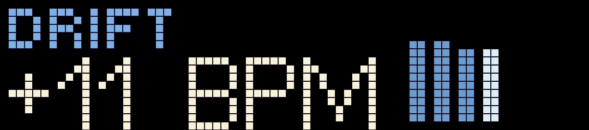
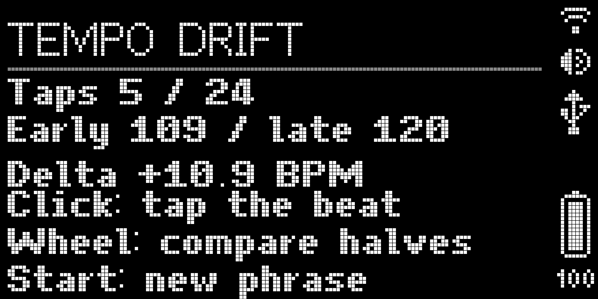
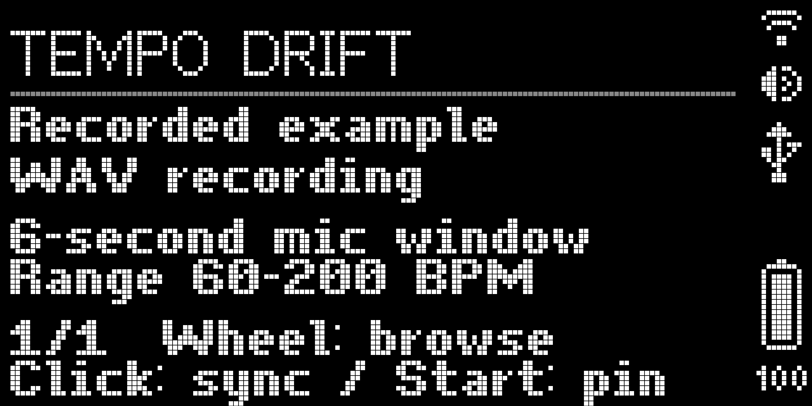

# Tempo Drift

Measure the tempo of music through a microphone or tap a phrase to compare its early and late beats.

An average tempo can hide a phrase that accelerates toward the end. Tempo Drift compares the first and last groups of beat intervals and shows how far apart they were.

The columns show the last seven measured gaps between taps, oldest first. A taller column means a longer gap. The newest gap is pale blue.

## Screen transitions

Tap a phrase, then turn through the timing measurements for that phrase.



<details>

<summary>Watch the rear display</summary>



</details>

Refresh the microphone reading and watch the reported BPM change across the recorded samples.


<details>

<summary>Watch the rear display in connected mode</summary>



</details>

## Tap a phrase

1. Click the wheel to tap consecutive beats. Five taps give four intervals and enough information to compare two halves.
2. After a pause longer than four seconds, a new phrase starts with your next tap. The recording begins with an earlier drift result and goes back to **Tap beat**.
3. Keep the spacing deliberate. Very close duplicate taps under a tenth of a second are ignored.


## Read the change across the phrase

1. Turn the wheel through **Tempo**, **Early**, **Late** and **Drift**. Early and late refer to the two ends of the same phrase.
2. Read the signed change on **Drift**. A positive difference means the second half was faster. Use the rear for the difference to one decimal place.
3. Press **Start** to clear the phrase before repeating it. The app retains up to 24 taps in the current phrase.


## Example from the emulator

If your early intervals average 500 ms, the early tempo is 120 BPM. Late intervals averaging 480 ms give 125 BPM, so drift is about +5 BPM. The high numbers in the recording come from quick test-button presses.

## Run in the emulator

Open BUSY Bar Emulator. From this repository, run:

```sh
~/.busy-emulator/bin/busy-emulator dev --once
```

Press **Back** to exit.

The GIFs are excerpts from the emulator recording. Each LED occupies a 16 × 16 cell with a black border. The end frames pause for reading.

[Full recording](media/controls.mp4) · [Rear display](screenshots/back-1.png) · [Firmware test](EMULATOR-QA.md) · [MIT license](LICENSE)

## Additional source setup

Leave Local companion URL empty to tap the beat on the wheel. For microphone mode, install `companion/requirements.txt` in a Python virtual environment. Give the companion computer microphone permission. On Linux install PortAudio if sounddevice cannot find it. To list audio inputs run `python3 -m sounddevice`. Add the chosen input index as `device` in the config, or use the default microphone. Place it where it can hear the music. You can also put a local 16-bit PCM WAV path in `wav`.

From the repository root, copy the example and start the companion with Python 3.10 or newer.

```sh
cp companion/example.json config.json
# Edit config.json for your source before starting the server.
python3 companion/serve.py --config config.json
```

In the emulator, run `~/.busy-emulator/bin/busy-emulator allow-local 8770` and approve that port. Open **Apps → Tempo Drift → Setup**, set **Local companion URL** to `http://127.0.0.1:8770/reading`, save, then reopen the app. For a physical bar, start the companion with `--host YOUR_LAN_IP` and replace `127.0.0.1` with that address. Bind only to your trusted network. Open `/reading` on the host to inspect the current reading. Keep credentials in the host environment.

## Measure a playing track

Start the companion with the example config. A six-second microphone capture estimates repeated onsets between 60 and 200 BPM. Keep the room quiet enough to hear the beat. The display reads Listening when the recording lacks enough rhythmic evidence.


## Compare two passages

Leave the app running through a tempo change or click to request a new reading. Syncopation and half-time rhythms can lead to a double- or half-tempo reading. Compare against tap mode if the displayed pulse differs from what you count.


The recordings use example responses on emulator firmware. Each LED occupies a 16 × 16 cell with a black border.

[python-sounddevice](https://python-sounddevice.readthedocs.io/).
