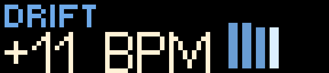

# Tempo Drift

Tap a pulse and see whether your playing sped up or slowed down across the phrase.

An average tempo can hide a phrase that accelerates toward the end. Tempo Drift compares the first and last groups of beat intervals and shows how far apart they were.

The columns show the last seven measured gaps between taps, oldest first. A taller column means a longer gap. The newest gap is pale blue.

## Tap a phrase

1. Click the wheel to tap consecutive beats. Five taps give four intervals and enough information to compare two halves.
2. After a pause longer than four seconds, a new phrase starts with your next tap. The recording begins with an earlier drift result and goes back to **Tap beat**.
3. Keep the spacing deliberate. Very close duplicate taps under a tenth of a second are ignored.



## Read the change across the phrase

1. Turn the wheel through **Tempo**, **Early**, **Late** and **Drift**. Early and late refer to the two ends of the same phrase.
2. Read the signed change on **Drift**. A positive difference means the second half was faster. Use the rear for the difference to one decimal place.
3. Press **Start** to clear the phrase before repeating it. The app retains up to 24 taps in the current phrase.


## Example from the emulator

If your early intervals average 500 ms, the early tempo is 120 BPM. Late intervals averaging 480 ms give 125 BPM, so drift is about +5 BPM. The high numbers in the recording come from quick test-button presses.

## Run in the emulator

Open BUSY Bar Emulator. From this repository, run:

```sh
~/.busy-emulator/bin/busy-emulator dev --once
```

Press **Back** to exit.

The GIFs are excerpts from the emulator recording. Each front-display pixel is shown at 9× its original width and height. The end frames pause for reading.

[Full recording](media/controls.mp4) · [Rear display](screenshots/back-1.png) · [Firmware test](EMULATOR-QA.md) · [MIT license](LICENSE)
